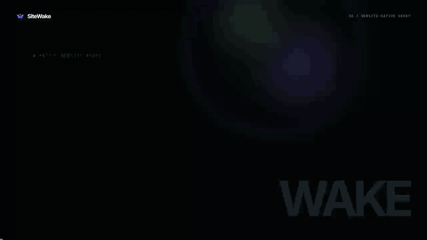

<div align="center">


# SiteWake

### 网站原生的 AI Agent —— 一行代码，无限能力

**把任何网站变成一个智能 Agent：理解你的用户、操作你的界面、自己学会新技能。**

🌐 **官网：[sitewake.ai](https://sitewake.ai)**

[](LICENSE)
[](https://www.typescriptlang.org/)
[](https://nextjs.org/)
[](compose.yaml)
[](CONTRIBUTING.md)
[](https://github.com/sitewake/sitewake)

[English](README.md) · **中文**

</div>

<div align="center">
  
  <br/>
  <sub>Agent 听懂目标、操作真实页面、完成任务。<a href=".github/assets/demo.mp4">观看完整画质视频（mp4，30 秒）</a>。</sub>
</div>

---

## ✨ 一行代码，就这么多

```html
<script src="https://your-sitewake-host/sitewake.js"
        data-site-agent="your-site-id"
        data-endpoint="https://your-sitewake-host"
        defer></script>
```

把这段代码放进任何页面 —— 纯 HTML、React、Next.js、Vue，任何能渲染 `<script>` 标签的技术栈都行 —— 你的网站立刻拥有一个 AI Agent，它会：

- 🗣️ **理解用户意图** —— 用户用自然语言说出目标即可
- 🖱️ **操作真实界面** —— 在用户自己的会话里点击、填写、导航真实页面
- 🧠 **持续自我进化** —— 成功经验沉淀为经过独立验证的可复用**能力（Capability）**
- 🚀 **零后端改造** —— 不需要 API 对接、不需要 MCP Server、不需要无头浏览器集群

> 当前为开源预览阶段。页面内执行、会话记录、网站知识和能力验证已经可用；自主学习与失效恢复仍需在真实网站上验证，暂不承诺任意网站装上即零维护。

---

## 🎯 为什么是 SiteWake？

大多数「网页 Agent」每次请求都要在服务端启动一个无头浏览器 —— 慢、无状态、看不到用户的真实上下文。**SiteWake 是 UI 原生的**：Agent 就活在你的页面*里*。

| | 传统网页 Agent | **SiteWake** |
|---|---|---|
| 执行方式 | 每次请求一个无头浏览器 | 用户真实的页面、真实的会话 |
| 登录态 | 重新认证 / 丢失 | 天然继承 |
| 学习 | 没有 —— 同样的错误一犯再犯 | 成功 → 经过验证、可复用的能力 |
| 接入 | 需要 API / MCP Runtime | 一个 `<script>` 标签 |
| 速度 | 每次冷启动 | 已发布能力确定性执行，不调用大模型 |

### 自我进化闭环

```text
用户说出目标
  └─ Agent 理解上下文，选择工具
       ├─ 查询网站知识：商品、页面类型、已知路径
       ├─ 调用已发布能力：像函数一样，有真实返回值
       ├─ 操作当前页面：只用于真正未知的缺口
       └─ 缺参数：就地追问，绝不猜

成功 → AI 设计能力契约 → AI 在独立浏览器里编写程序
     → 独立真实重放 → 发布为全站共享的能力

失败 → 区分业务拒绝与执行故障
     → 只修真正的执行缺口
```

每一次真实任务都让你网站的 Agent 更聪明。一页一页，控制台被学到的知识点亮。

---

## 🖥️ 控制台

不是训练后台，而是一个你能看着它长大的**活的 Agent**：

- **📊 概览** —— 实时的网站模型：Agent 学到了什么、形成了哪些能力
- **🤖 Agent** —— 助手在你页面上的外观与行为，按访客看到的样子预览
- **📜 用户会话** —— 每个任务的结果：已完成 / 无结果 / 业务拒绝 / 执行故障，附逐步操作记录
- **⚡ 能力** —— 只收完整、可靠交付的用户目标；导航点击永远冒充不了业务能力
- **🗺️ 网站知识** —— 网站的页面结构与已收录内容，每条事实都带来源

---

## 🚀 快速开始

二选一：

- **Docker**（含 Compose v2）—— 部署到服务器或 NAS。
- **Node.js ≥ 22.13** —— 在自己的电脑上跑，用于开发。

再加一个 OpenAI 兼容模型服务的 API Key（见[模型要求](#-模型要求)）。

`./setup` 是一个交互式向导。它先问 SiteWake 跑在哪，再问你的模型服务，用真实请求验证模型**通过之后**才写入配置，替你生成 Docker Compose 需要的全部密钥，最后打印下一条命令。克隆完立刻就能跑，不需要先 `npm install`。机器上没有 Node.js 的话，它会在一个用完即弃的 `node:22-alpine` 容器里跑同一个向导。

### 用 Docker Compose 部署（推荐）

标准的开源部署方式。一条命令启动控制面、PostgreSQL、MinIO、AI 程序编写者，以及独立的验证 / 执行 worker：

```bash
git clone https://github.com/sitewake/sitewake.git
cd sitewake
./setup
docker compose up -d --build
```

`./setup` 会问这几件事，然后写入 `.env`：

1. **语言** —— English 或中文。
2. **SiteWake 以哪种方式运行** —— 选 *用 Docker Compose 运行 —— 正式部署*。
3. **模型提供方** —— 从已验证的提供方里选（OpenAI、阿里云百炼、智谱、火山方舟；Base URL 自动填好），或手动填其他 OpenAI 兼容服务的 Base URL。
4. **API Key** —— 在提供方控制台创建；输入不回显，写入 `.env` 的 `MODEL_API_KEY`，不会发送到访客的浏览器。
5. **模型** —— 提供方模型列表里的准确 id；必须支持工具调用（向导会列出已验证的家族）。
6. **访客怎么访问到这台服务器** —— 本机试用、域名（HTTPS 网站必须选这个）、公网 IP，或局域网。向导据此得出网站加载 SDK 的服务器地址，例如 `https://agent.example.com`。

然后它向模型发出两阶段真实请求，都通过才写文件。数据库和 MinIO 的口令、四个 runner 密钥由向导替你生成；以后重跑 `./setup` 会原样保留它们。之后想换模型：重跑 `./setup`（密钥直接回车保留），或者改 `.env` 里的 `MODEL_BASE_URL`、`MODEL_API_KEY`、`MODEL`，再 `docker compose up -d`。

**任何 OpenAI 兼容模型服务**都能用，不绑定厂商。整套服务监听 3000 端口；打开你填的那个 Origin。

小机器（2 核 / 2 GB）用紧凑配置 —— 浏览器一次只开一个、单个 worker：

```bash
docker compose -f compose.yaml -f compose.compact.yaml up -d --build
```

确认健康：

```bash
curl -s http://127.0.0.1:3000/api/health
docker compose exec -T control-plane node scripts/container-smoke.mjs
```

健康响应必须包含 `"runtime":"container"`。烟测会检查数据库、对象存储、Runner 注册、模型配置与 SDK。

### 本地开发（Node ≥ 22.13）

```bash
git clone https://github.com/sitewake/sitewake.git
cd sitewake
./setup
npm install
npx playwright install chromium
npm run dev
```

`./setup` 写入 `.env.local`。被问到运行方式时选**用 Node.js 从源码运行 —— 开发调试**。`npx playwright install chromium` 下载 runner 抓取网站用的浏览器内核（几百 MB，只需一次）。`npm run dev` 会先做启动前检查 —— Node 版本、浏览器、模型配置、端口占用 —— 缺什么一次性列全。

然后打开 **<http://localhost:3000>**。

Windows 上没有 WSL 的话，用 `node scripts/setup.mjs` 代替 `./setup`。

### 控制台打开之后

它最先展示的是三步接入引导：**创建网站 → 加入那一行代码 → 检测连接**。用你自己的网站走一遍；它给出的代码已经带着真实的站点标识和 SDK 地址。控制台报告已连接之后，SiteWake 会自动开始读取网站知识 —— 通常几分钟，进度在**网站知识**页，那里也随时可以手动重读。这期间打开你的网站，先让助手做一件只读的事 —— 比如找一款商品 —— 再回到控制台的会话记录看它做了什么。不再需要的网站在**网站设置 → 数据 → 删除网站**里删掉，连同它学到的一切。

把控制台暴露到公网之前，先在 `<你的 Origin>/access` 设置密码。设置之前，任何能访问到它的人都能打开控制台。

---

## 🧠 模型要求

任何 OpenAI 兼容的 chat completions 接口都可以用，只有一条硬性要求：模型必须支持**强制工具调用**（`tool_choice` 指定函数名）。聊天正常的模型仍可能无法操作页面；`./setup` 会在写入配置之前同时发送路由请求和真实的页面执行请求，把这种情况拦下来。

每个提供方还需要一份经过验证的请求策略，因为其中几家要求在强制工具调用时关闭思考模式。目前已验证：

| 提供方 | Base URL 主机 | 模型 |
| --- | --- | --- |
| OpenAI | `api.openai.com` | `gpt-*`、`o1`、`o3`…… |
| 阿里云百炼 | `dashscope.aliyuncs.com`、`*.maas.aliyuncs.com` | `qwen*` |
| 智谱 | `open.bigmodel.cn` | `glm*` |
| 火山方舟 | `ark.*.volces.com` | `doubao*`、`deepseek*`、`glm*`、`kimi*`、`qwen*` |

换成其他提供方时，`./setup` 会停在 `provider payload policy: …`。把该提供方加进 [`lib/site-knowledge/provider-payload-policy.ts`](lib/site-knowledge/provider-payload-policy.ts)，再用 `npm run check:model-compat` 验证。

---

## 🔧 常见问题

**`./setup` 报 401 或 403** —— 服务不接受这个密钥。检查密钥本身，以及它是否属于该 Base URL 对应的服务。

**`./setup` 报 404** —— 多半是 Base URL 少了或多了 `/v1`。按提供方文档原样填写，例如 `https://api.openai.com/v1`。

**`./setup` 连不上** —— 检查 Base URL 和这台机器的网络。如果 `./setup` 是在容器里跑的（机器上没有 Node.js），只在你 shell 里设置的代理对它不可见。

**SDK 在我的网站上加载不出来** —— `SITEWAKE_PUBLIC_ORIGIN` 必须是访客浏览器能访问到的地址，服务器上不能填 `localhost`。如果你的网站是 HTTPS，这个 Origin 也必须是 HTTPS：在 3000 端口前面放一个 TLS 反向代理（Caddy、nginx、Cloudflare Tunnel），然后用那个 HTTPS Origin 重跑 `./setup`。

**`npm run dev` 说 Playwright 浏览器内核未安装** —— 执行 `npx playwright install chromium`。跳过它一切都能启动，直到 runner 第一次需要抓取网站。

---

## 🏗️ 架构

```text
┌────────────────────────── 你的网站 ─────────────────────────────┐
│  <script sitewake.js>                                            │
│    └─ 用户 Agent ── DOM 驱动 ── BrowserPort（跨页）              │
└─────────────────────────────┬────────────────────────────────────┘
                              │ site-agent 协议
┌─────────────────────────────▼────────────────────────────────────┐
│                       控制面（Next.js）                           │
│   AgentRun 存储 · 网站知识 · 发布门禁 · 控制台                    │
├──────────────────┬──────────────────────┬────────────────────────┤
│  AI 程序编写者    │  验证 worker         │  执行 worker           │
│                  │  （独立重放）         │  （确定性执行）         │
├──────────────────┴──────────────────────┴────────────────────────┤
│               PostgreSQL  ·  MinIO  ·  Docker Compose            │
└──────────────────────────────────────────────────────────────────┘
```

---

## 📚 文档

使用指南、浏览器 SDK API 参考（`SiteWake.run()`、`SiteWake.call()` 等）、架构地图与部署说明都在官网：**[sitewake.ai](https://sitewake.ai)**。

仓库内：[CONTRIBUTING.md](CONTRIBUTING.md) 讲怎么运行与修改代码，[SECURITY.md](SECURITY.md) 讲部署边界，[CHANGELOG.md](CHANGELOG.md) 记录每个版本的变化。

---

## 🤝 参与贡献

开源的精彩来自每一份贡献。无论是 bug 报告、功能想法、文档改进还是 pull request —— **都欢迎！**

1. Fork 仓库
2. 建分支：`git checkout -b feature/amazing`
3. 跑检查：`npm run lint && npm test`
4. 提交：`git commit -m "feat: something amazing"`
5. 发起 pull request

约定见 [CONTRIBUTING.md](CONTRIBUTING.md)，安全问题的报告方式见 [SECURITY.md](SECURITY.md)。

---

## 📄 开源协议

SiteWake 以 [MIT 协议](LICENSE) 开源——使用、修改、分发、商用都可以，保留版权声明即可。

浏览器 SDK 打包了几个 MIT 协议的依赖，主要是阿里巴巴的 [Page Agent](https://github.com/alibaba/page-agent)。它们的版权声明附在构建出的 `sitewake.js` / `sitewake-adaptive.js` 末尾，并列在 [THIRD_PARTY_NOTICES.md](THIRD_PARTY_NOTICES.md)。能力编写用的页面契约来自 [OpenCLI](https://github.com/jackwener/OpenCLI)（Apache 2.0），归属见 [NOTICE](NOTICE)。

---

## ⭐ Star 趋势

如果 SiteWake 帮到了你，一个 ⭐ 对我们意义重大！

[](https://star-history.com/#sitewake/sitewake&Date)

---

<div align="center">

**[sitewake.ai](https://sitewake.ai)** · [GitHub](https://github.com/sitewake/sitewake) · [MIT 协议](LICENSE) © 2026 SiteWake contributors

</div>
